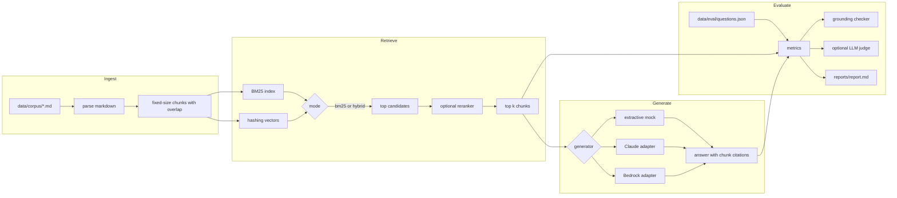

# rag-eval-harness

A small retrieval-augmented generation (RAG) pipeline and the evaluation harness around it. The harness answers one question: when you change chunk size, retrieval depth, the retriever, or the model, do the answers get more correct, stay grounded in the source text, and refuse when the documents do not have the answer?

Everything runs offline on Python 3.12 with no third-party packages. Real models (Anthropic Claude, Amazon Bedrock) plug in through optional adapters.

## The problem

A RAG demo that "looks right" on five questions tells you little. Teams need numbers they can compare across changes:

- Did retrieval find the right document? (recall@k, MRR)
- Does the answer contain the expected facts? (fact match, optional LLM judge)
- Is every sentence backed by the chunk it cites, or did the model invent something? (grounding)
- Does the system say "I don't know" for questions the documents cannot answer? (refusal accuracy)
- What does it cost and how long does it take? (token estimate, latency)

This project builds all five measurements over a fictional product, Acme Payments, with 26 short documents and 40 test questions, 5 of which have no answer in the corpus.

## Architecture



| Module | What it does |
|---|---|
| `rageval/corpus.py` | Loads markdown and splits it into word windows with overlap. Chunk ids look like `refunds-policy#c0`. |
| `rageval/bm25.py` | Okapi BM25 with an inverted index, written from scratch. |
| `rageval/embedding.py` | Feature-hashing vectors of words and word pairs. A stand-in for an embedding model. |
| `rageval/retriever.py` | BM25 or hybrid (min-max blend of BM25 and cosine), then an optional reranker that rewards query coverage. |
| `rageval/generation.py` | The prompt, the refusal rule, citation parsing, the offline mock generators, and the LLM wrapper. |
| `rageval/llm.py` | Claude (Anthropic SDK) and Bedrock (boto3 Converse) adapters. Both import their SDK only when used. |
| `rageval/grounding.py` | Splits the answer into sentences and checks each one against the chunks it cites. |
| `rageval/metrics.py` | Recall@k, MRR, fact match, refusal accuracy, percentiles. |
| `rageval/judge.py` | Optional LLM-as-judge with a 0/1/2 rubric. |
| `rageval/runner.py` | Runs one config over the eval set and aggregates the metrics. |
| `rageval/report.py` | Writes the markdown comparison report. |

## Quickstart

```bash
python3.12 -m venv .venv && source .venv/bin/activate
pip install -e '.[dev]'

python -m pytest
python -m rageval run --config configs/*.json
```

The run prints the comparison table, writes `reports/report.md`, and writes one JSONL file per config with every question, answer, citation, and verdict to `reports/runs/`.

To use Claude as the generator and the judge:

```bash
pip install -e '.[anthropic]'
export ANTHROPIC_API_KEY=...
cp configs/claude-sonnet.json.example configs/06-claude-sonnet.json
python -m rageval run --config configs/01-baseline.json configs/06-claude-sonnet.json
```

The Claude adapter defaults to `claude-sonnet-5-5`. The Bedrock adapter (`"generator": {"type": "bedrock", "model": "...", "region": "..."}`) is a placeholder that uses the boto3 Converse API; it is not exercised by the tests.

### Config format

```json
{
  "name": "03-hybrid-rerank",
  "description": "BM25 plus hashing vectors (alpha 0.5), reranked, top 4.",
  "chunking": {"size": 120, "overlap": 30},
  "retrieval": {"mode": "hybrid", "k": 4, "rerank": true, "hybrid_alpha": 0.5},
  "generator": {"type": "mock"},
  "cost_model": "claude-sonnet-5-5",
  "judge": null
}
```

`generator.type` is one of `mock`, `mock-hallucinating`, `claude`, or `bedrock`. `cost_model` sets the price used for the cost projection, so you can see what a config would cost on a real model before you pay for a run.

## Sample report

This is the real output of `python -m rageval run --config configs/*.json` on this repository. Latency is wall-clock time for retrieval plus generation on a laptop, so it varies between runs.

| Config | Chunk/overlap | Retriever | k | Generator | Recall@k | MRR | Fact recall | Accuracy | Grounded sent. | Halluc. answers | Refusal acc. | p50 ms | p95 ms | Est. $/1k q |
|---|---|---|---|---|---:|---:|---:|---:|---:|---:|---:|---:|---:|---:|
| 01-baseline | 120/30 | bm25 | 4 | mock-extractive | 1.000 | 0.986 | 0.857 | 0.857 | 1.000 | 0.000 | 0.900 | 0.19 | 0.24 | 1.500 |
| 02-small-chunks | 30/5 | bm25 | 4 | mock-extractive | 1.000 | 1.000 | 0.786 | 0.771 | 1.000 | 0.000 | 0.875 | 0.10 | 0.11 | 0.825 |
| 03-hybrid-rerank | 120/30 | hybrid a=0.5 + rerank | 4 | mock-extractive | 1.000 | 0.986 | 0.857 | 0.857 | 1.000 | 0.000 | 0.900 | 0.66 | 0.74 | 1.500 |
| 04-k1 | 120/30 | bm25 | 1 | mock-extractive | 0.943 | 0.971 | 0.829 | 0.829 | 1.000 | 0.000 | 0.875 | 0.06 | 0.08 | 0.735 |
| 05-hallucination-probe | 120/30 | bm25 | 4 | mock-hallucinating | 1.000 | 0.986 | 0.714 | 0.714 | 0.714 | 0.452 | 0.900 | 0.20 | 0.25 | 1.535 |

What the table shows:

- **Small chunks are cheaper but lose facts.** 30-word chunks cut the prompt roughly in half, but some facts split across a chunk boundary, so accuracy falls from 0.857 to 0.771.
- **Top 1 is cheapest but misses multi-source questions.** Two questions have two gold documents, so k=1 finds only half of their gold set. For one more question (the minimum TLS version), BM25 ranks the wrong document first, so the answer becomes a false refusal.
- **Hybrid retrieval plus reranking changes the order of lower-ranked chunks (29 of 40 lists differ) but not the top hit.** On this small, keyword-friendly corpus BM25 already finds the gold document for every question, so the extra cost buys nothing here. The comparison is still the point: you measure before you add complexity.
- **The grounding check catches injected errors.** The hallucination probe corrupts about 30% of answers by changing a number or adding an invented sentence. The checker flags all 14 corrupted answers and no clean ones (45% of answered questions), and the grounded-sentence rate falls to 0.714. Examples from the report:
  - `"International cards cost an additional 2.5% on top of the domestic rate. [pricing-standard#c0]"` flagged with `numbers not in cited text: 2.5`
  - `"Acme waives this fee for registered nonprofit organizations. [pricing-ach#c0]"` flagged with `low term support 0.33`
- **All 5 unanswerable questions are refused in every config.** The 4 or 5 false refusals per config come from wording gaps, for example "give back the processing fee" against a document that says "does not return the original processing fee".

## Design trade-offs

- **Extractive mock instead of a hosted model by default.** The harness must run in CI with no network, no key, and no cost, and it must give the same numbers every time. The mock picks the retrieved sentences that cover the most question terms (weighted by idf) and refuses below a coverage threshold. That makes it a fair stand-in for the retrieval-to-answer path, but it cannot paraphrase or reason.
- **Fact match before LLM judge.** Expected facts are short strings ("$15", "5 to 10 business days") matched after normalization. This is cheap, transparent, and strict. It undercounts correct paraphrases, which is why the optional judge exists. The judge costs money and adds its own variance, so it is off by default.
- **Lexical grounding check.** A sentence is supported when it cites a retrieved chunk, at least 75% of its content words appear in that chunk, and every number in it appears in that chunk. Numbers get a hard rule because pricing and limits are where a wrong answer hurts most. An entailment model would catch more subtle errors but would add a heavy dependency.
- **Hashing vectors instead of a real embedding model.** They show the hybrid plumbing (score fusion, normalization, reranking) without a model download. They are still lexical, so they cannot match synonyms. Swap in a real embedder behind the same `embed()` call to test semantic retrieval.
- **Cost from estimated tokens.** The mock reports tokens as characters divided by four for the exact prompt an LLM would receive. Real adapters report provider usage. Prices live in `rageval/cost.py`; check them against the provider price page before you rely on them.
- **Stdlib only.** No numpy, no vector store, no framework. Every metric is a few lines you can read and test.

## Limitations

- The corpus is small, fictional, and written to be clear. Retrieval saturates, so it cannot separate strong retrievers from weak ones. A harder corpus with near-duplicate documents and vocabulary drift would.
- 40 questions give coarse numbers. One question moves accuracy by about 3 points, so treat small differences as noise.
- The mock never produces fluent but wrong answers on its own. The hallucination probe injects them on purpose to test the checker; it is not a model of real model behavior.
- The grounding check works on word overlap. It can pass a sentence that reorders cited words into a false claim, and it can fail a correct paraphrase.
- Latency for the mock is microseconds and says nothing about a real model. The Claude and Bedrock adapters report real latency, but the tests do not call them.

## Next steps

- Add a harder corpus split with paraphrased questions to stress retrieval.
- Plug in a real embedding model and compare hybrid against BM25 where synonyms matter.
- Run the Claude config and compare fact match against the LLM judge to measure how often strict matching undercounts correct answers.
- Add confidence intervals (bootstrap over questions) to the report so that small differences are not over-read.
- Add an entailment-based grounding checker and compare its verdicts with the lexical one.

## License

MIT. See [LICENSE](LICENSE).
